

  

  &nbsp;
  &nbsp;
  &nbsp;
  

 

  

 

### [0x01 // SYSTEM_OVERVIEW]

Double major in **Physics** and **Computer Science**, constructing software at the boundary of mathematical rigor and high-performance engineering. Academic foundations in theoretical physics are applied directly to systems programming, low-latency execution sandboxes, and cryptographic simulations.

Utilizes diverse architectures for cross-platform deployments, with deep operations in **distributed systems design**, **theoretical computation**, and **adversarial security research**. Every construct is engineered to a standard of minimal dependencies, mathematical verification, and strict operational utility.

 

  

 

### [0x02 // SELECTED_PROJECTS]

<table>
  <tr>
    <td width="50%"><a href="https://github.com/Anubisx404/Dijkstra-Algorithm-Visualization">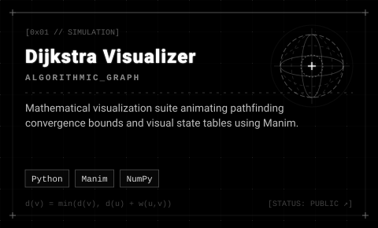</a></td>
    <td width="50%"><a href="https://github.com/Anubisx404/Fourier-Transform">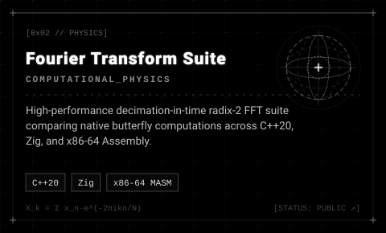</a></td>
  </tr>
  <tr>
    <td width="50%">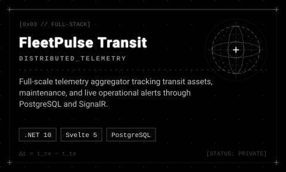</td>
    <td width="50%">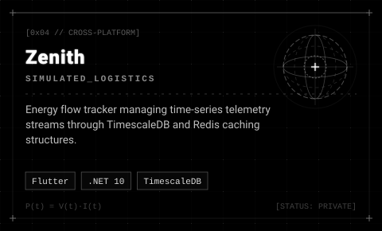</td>
  </tr>
  <tr>
    <td width="50%"><a href="https://github.com/Anubisx404/Grace_Boutique">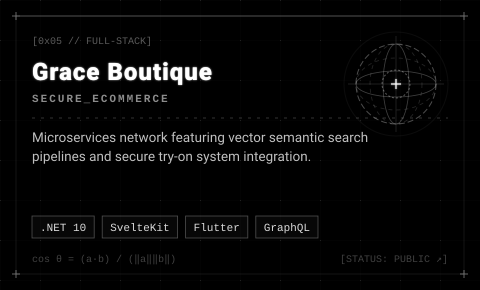</a></td>
    <td width="50%">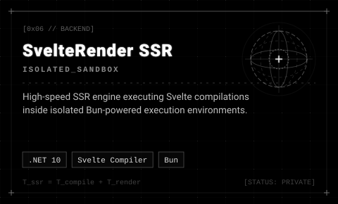</td>
  </tr>
  <tr>
    <td width="50%"><a href="https://github.com/page-ui/Backend_Department">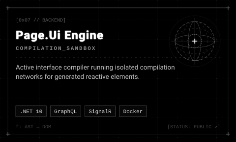</a></td>
    <td width="50%"><a href="https://github.com/Anubisx404/Mirox">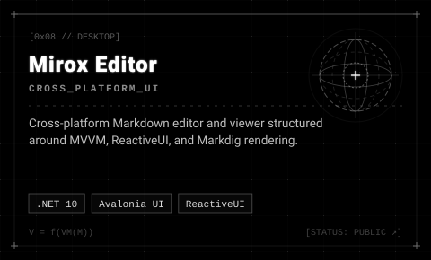</a></td>
  </tr>
  <tr>
    <td width="50%"><a href="https://github.com/Anubisx404/Extent">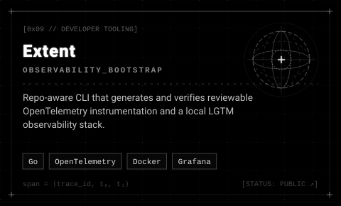</a></td>
    <td width="50%"><a href="https://github.com/MuonByte/Education_Manager">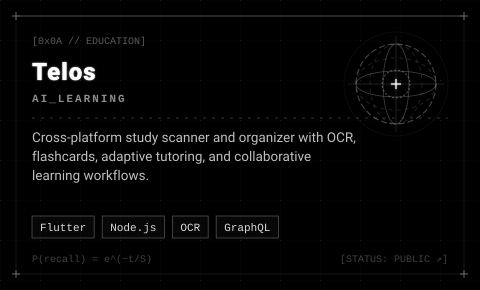</a></td>
  </tr>
  <tr>
    <td width="50%">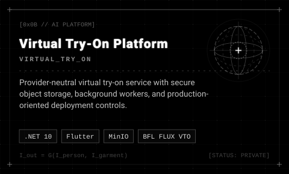</td>
    <td width="50%">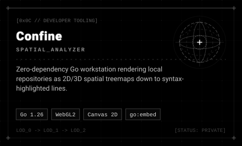</td>
  </tr>
  <tr>
    <td width="50%">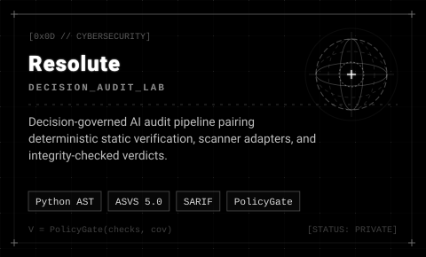</td>
    <td width="50%">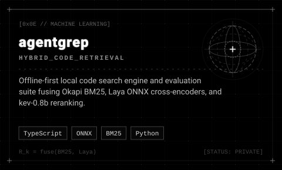</td>
  </tr>
</table>

 

  

 

### [0x03 // OPEN_SOURCE_&_TEAM_CONTRIBUTIONS]

| Project | Role | Verified Scope |
|:---|:---|:---|
| **[bynat-lab/bynat](https://github.com/bynat-lab/bynat)** | Core Contributor | Decomposed `Cleaning.py` and `CacheManager`, implemented the non-mutating `df.bynat` pandas accessor API, added `mypy` CI + PEP 561 static stubs with synced docstrings, and executed the `TEST-03`–`TEST-07` testing constitution reorganization (`22` commits). |
| **[MindFeed-Org/MindFeed](https://github.com/MindFeed-Org/MindFeed)** | Backend & Clean Architecture | Built Supabase migrations, RLS hardening, `SECURITY INVOKER` RPC triggers, `auth-confirm` 302 Edge Function, Feature-First Clean Architecture (`auth`, `profile`, `home`, `reader`, `add_article`), offline Hive reader, swipe deck, and unsigned iOS IPA CI workflow (`41` commits). |

 

  

 

### [0x04 // TECH_STACK]

| Languages | Frameworks | Databases | Infrastructure / Observability | Tools |
|:---:|:---:|:---:|:---:|:---:|
|  |  |  |  |  |

 

<b>Protocols and Specialized Tools</b>

 

| Category | Technologies |
|:---|:---|
| **Protocols** | HTTP, WebSocket, gRPC, GraphQL, SignalR |
| **Auth and API** | Auth0, Swagger / OpenAPI |
| **Frameworks** | Blazor, Qt, wxWidgets |
| **Scientific** | Mathematica |
| **Creative** | Premiere Pro, After Effects, QGIS |

 

  

 

  

 

  

